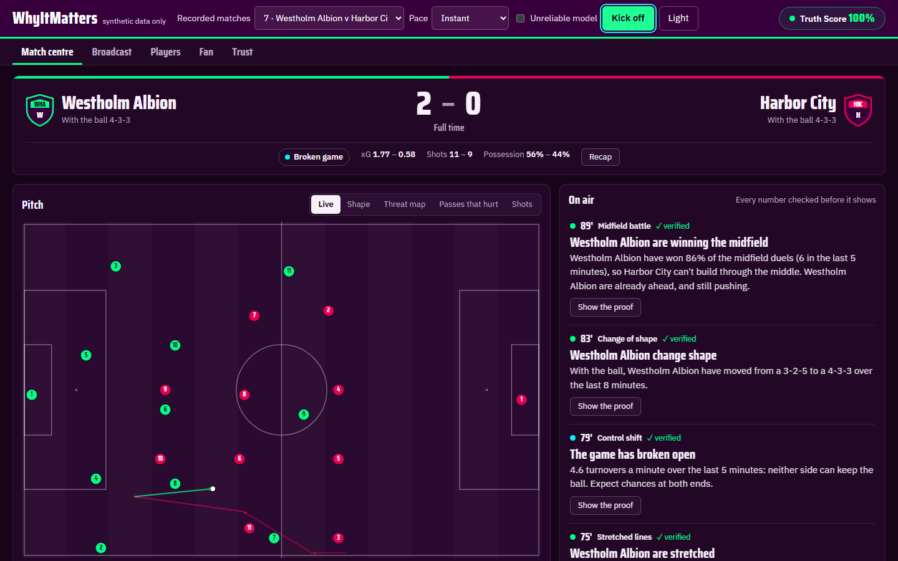
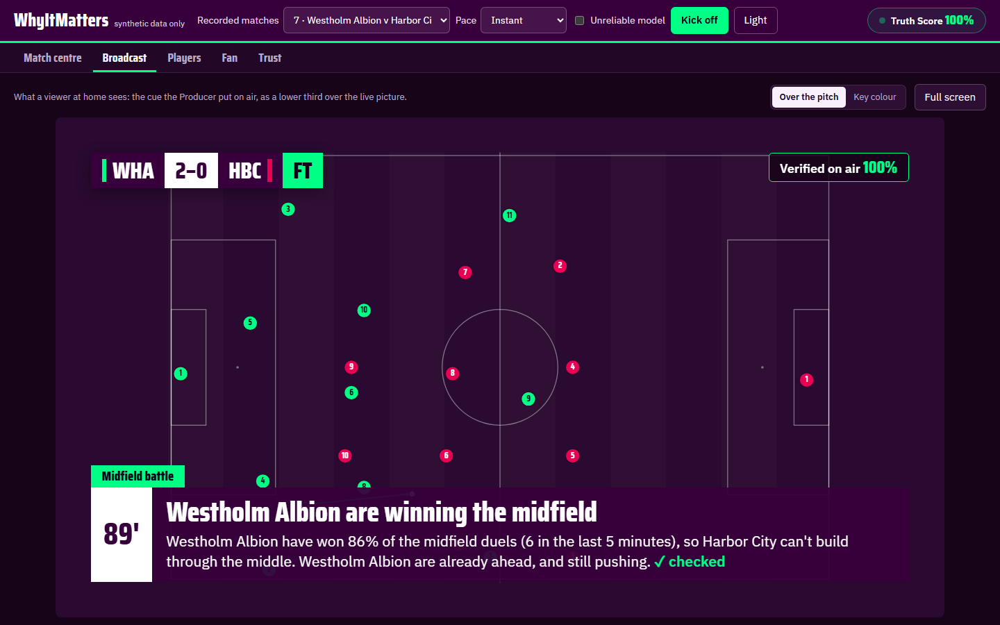
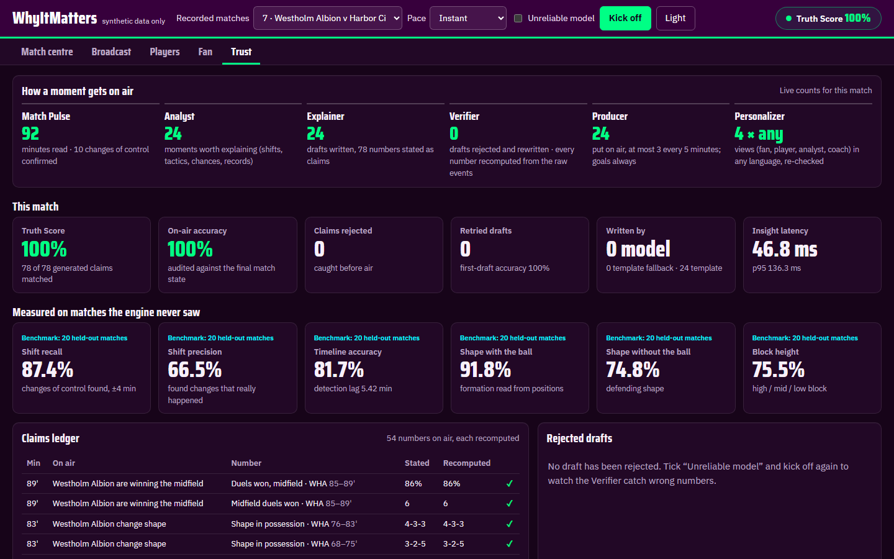
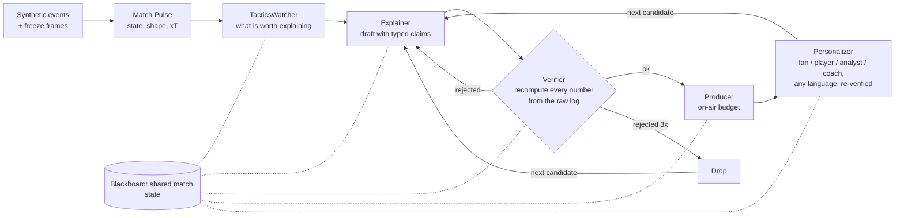

# WhyItMatters

[](https://github.com/isaacboque/why-it-matters/actions/workflows/ci.yml)

**Reads the game like a coach, explains it like a pundit, and proves every word.**

## For judges: 60-second tour

| Link | |
| --- | --- |
| Live demo (Azure Container Apps) | LIVE_DEMO_URL |
| Static demo (no backend) | STATIC_DEMO_URL |
| Demo video | VIDEO_URL |

1. Open the demo, leave Pace on **Live** (or pick **Fast**) and press **Kick off**. Match centre fills with the pitch, xT momentum and the on-air rail.
2. On any card in the on-air rail, press **Show the proof**: the number stated next to the number recomputed from the raw event log.
3. Open **Broadcast** to see the same cue as a 16:9 lower third over the live picture.
4. Open **Trust**, tick **Unreliable model** and kick off again: the Verifier catches wrong numbers before they air, and the claims ledger and rejected drafts show it.

| Match centre | Broadcast | Trust |
| --- | --- | --- |
|  |  |  |

WhyItMatters turns a live stream of synthetic, football-realistic match events into explainable match intelligence for studio, broadcast and streaming. A Match Pulse engine tracks control vs chaos, pressing intensity, field tilt and rhythm; a team of agents explains why each shift matters, verifies every claim against the match state, decides what goes on air, and personalizes it for analysts and fans.

Built for the Microsoft × Premier League **Inside the Game: Developer Hackathon** (challenge: *The Synthetic Match Insights Engine for Premier League Studio*).

> **Data policy:** synthetic data only. Every club, player and match in this repository is fictional and generated by code. No real Premier League data, footage or marks are used.

## Status

| Stage | Component | State |
| --- | --- | --- |
| Ingest | Seeded synthetic simulator with ground truth | done |
| Interpret | Match Pulse engine (control/chaos, PPDA, field tilt, rhythm) | done |
| Explain | Agent team: Blackboard, Analyst, Explainer, Verifier, Producer, Recap, orchestrator + event bus (offline, deterministic) | done |
| Render | Overlay cue JSON with on-air budget, full-time recap | done |
| Render | FastAPI (SSE stream, overlay cue JSON), Studio / Fan / Trust views, Docker | done |
| Interpret | Tactical engine: duels by zone, high recoveries, counter-press, dangerous losses, progressive passes, long-ball share, driver attribution, build-up of goals | done |
| Explain | Cause → effect insights (press surge, midfield battle, dangerous turnovers, going long), hardest pass, fastest shot; every driver is a Verifier-checked claim | done |
| Ingest | Freeze frames: positions of all 22 players at every event, with scripted in/out-of-possession shapes and block heights as ground truth | done |
| Interpret | Team shape (formation in and out of possession, line height, gaps between lines, length, width, compactness) and Expected Threat (fitted 16 × 12 grid, xT added per action, xT momentum) | done |
| Interpret | Damage: line-breaking passes, packing (opponents bypassed), receptions between the lines, box / zone 14 / half-space entries, threat by lane, most dangerous pass | done |
| Explain | Damage and shape insights: playing through the lines, danger down one lane, momentum swing (xT), change of shape, stretched lines, the pass that broke it open; each number a Verifier-checked claim | done |
| Render | Match Centre (scorebug, pitch layers: live 22 players / shape / threat map / passes that hurt / shots, xT momentum, head to head), Broadcast lower-third overlay, Players table, Trust control room (pipeline counts, claims ledger, held-out benchmarks, rejected drafts) | done |
| Explain | Varied wording (rotating alternatives per insight) and the score situation ("just what they need while they're behind"), still number-free outside verified claims | done |
| Personalize | Analyst / fan / player-focus / coach modes, "My metric" thread, EN · ES · CA offline, re-verified | done |
| Personalize | Optional model-written captions in any language (Azure OpenAI / Foundry or GitHub Models), guarded: numbers, names, length, retry, template fallback, cost cap | done |

See [SPEC.md](SPEC.md) for the problem, users, success criteria and architecture.

## Measured, not claimed

The simulator plants known answers (who controls the game, when it turns to chaos, which chances mattered), so the Match Pulse engine is scored against them on matches it was never tuned on:

| Held-out matches | Shift recall | Shift precision | Timeline accuracy | Detection lag |
| --- | --- | --- | --- | --- |
| 20 | 0.84 | 0.61 | 0.81 | 5.3 min |

CI fails if any of these drop below target.

The agent team is scored on seeds 0–19 (offline template generator):

| Measure | Result |
| --- | --- |
| Truth Score (claims passing the Verifier) | 1.00 |
| Truth Score with a model that mis-states 30 % of first drafts | 0.93 raw; first-draft accuracy 0.70; every retry recovers; on-air accuracy 1.00 |
| Cues per match | 22.6 (18–26); goals always air |
| Insights per match | 23.3: 7.2 control/chaos shifts, 2.8 goals, 2.9 changes of shape, 1.7 line-breaking spells, 1.0 going long, 0.7 danger down one lane, 0.6 press surges, 0.5 stretched lines, 0.5 killer passes, 0.4 momentum swings, 0.3 dangerous turnovers, 0.3 midfield battles, 1.1 hardest passes, 0.8 fastest shots, plus chances, top speed, passing milestones |
| Change of shape vs the scripted shape in possession | 0.84 precision (43/51) on held-out seeds 1000–1019; 0.87 (53/61) on tuning seeds 0–19 |
| Stretched lines inside a scripted broken (chaos) spell | 0.77 (10/13) on held-out seeds; 0.67 (6/9) on tuning seeds |
| Formation detection vs scripted shape (held-out, 1,868 windows) | out of possession 0.75, in possession 0.92; block type (high / mid / low) 0.76 |
| Driver attribution: a pressing metric is among the top drivers of a correctly detected control shift | 71 % (45/63) on tuning seeds 0–19; 79 % (54/68) on held-out seeds 1000–1019 |
| Latency per insight | 12.5 ms mean, 55 ms max (the Verifier replays the log, freeze frames included) |

## How the agents work together



- **Shared state:** every agent reads the same Blackboard: match state, rolling windows and the raw event log. The Verifier recomputes from the raw log, not from what the writer saw.
- **Typed handoffs:** each number travels as a `Claim` (metric, value, window or event, tolerance), so the text can't say anything the data doesn't back.
- **Microsoft Agent Framework:** the whole pipeline (TacticsWatcher → Explainer → Verifier with retry/drop → Producer → Personalizer) runs as one Agent Framework workflow graph (`agents/workflow.py`), one run per match event. Each agent is an `Executor`, and conditional edges route each draft on the Verifier's verdict. Switch it on with `WIM_ENGINE=agent_framework`, the default in the container. A test proves it gives identical results to the inline loop.
- **Microsoft Foundry:** a model deployed in Foundry can write the captions in any language, under the same checks ([docs/LLM.md](docs/LLM.md)).
- **Azure Container Apps:** the app is hosted there with one command from Cloud Shell ([docs/DEPLOY.md](docs/DEPLOY.md)).

## Microsoft technologies used

Only what is in the code and the deploy scripts today:

| Technology | Where | Judging criteria it serves |
| --- | --- | --- |
| Microsoft Agent Framework | The whole pipeline (watch, draft, verify, retry/drop, produce, personalize) is one workflow of `Executor`s with conditional edges (`src/whyitmatters/agents/workflow.py`, `WIM_ENGINE=agent_framework`); a parity test pins cues, verdicts and Truth Score to the inline engine on seeds 0-4 | Technical execution, innovation |
| Microsoft Foundry / Azure OpenAI | Optional caption writer (`WIM_GENERATOR=llm`), guarded by number, name and length checks, retries, template fallback and a per-match cost cap ([docs/LLM.md](docs/LLM.md)) | Innovation, responsible AI |
| Azure Container Apps | Hosting, one script from Cloud Shell, one replica kept warm ([docs/DEPLOY.md](docs/DEPLOY.md), `infra/deploy.sh`) | Technical execution, real-world applicability |
| GitHub Actions and GHCR | CI (lint, tests, detection eval gate, Playwright browser tests), image published to GHCR (`.github/workflows/`) | Technical execution |

GitHub Copilot is not used in the shipped code, so it is not listed.

## Path to production

This is a prototype on synthetic data. What it would take to run on a real feed, kept short:

- **Provider adapter.** One function per provider maps its event feed onto our schema (`src/whyitmatters/schema.py`) and nothing downstream changes. An Opta or StatsBomb-style feed needs, per event: `id`, `seq`, `t`, `period`, `minute`, `type`, `side`, `player_id`, `possession_id`, `x`/`y` and `end_x`/`end_y` (converted to the acting team's 105 x 68 m coordinates), `outcome`, `receiver_id`, `under_pressure`, `xg`, `score_home`/`score_away`, plus a `freeze` frame of all 22 players where the provider has tracking (StatsBomb 360 style). Field definitions are in [docs/DATA.md](docs/DATA.md). The adapter itself is not built yet.
- **Latency per insight.** Measured offline on the replayed log, not on a network: see the Trust tab and the table above. A live feed adds the provider's own delay.
- **On-air budget.** The Producer allows at most 3 cues per rolling 5 match minutes; goals always air. Tune per broadcaster.
- **Overlay cue API.** `GET /matches/{seed}/cues` returns timed cues (`t_in`, `t_out`, `priority`, `headline`, `body`, evidence event ids, claims) for a graphics partner; today it is pull-based per match, a push channel would be next.
- **Audit trail.** Every number on air is a typed claim with its recomputed value; the claims ledger in the Trust tab is that trail. Persisting it per broadcast is not built yet.
- **Cost guard.** `WIM_LLM_MAX_CALLS` caps model requests per match and everything falls back to offline templates; the default path needs no model at all.

## How to read our numbers

- **Truth Score** is the share of claims that match a recomputation from the raw event log, which the Verifier does independently of the writer. On clean drafts it is 1.00 by construction, so on its own it is weak evidence.
- **The stronger evidence is the fault-injection test:** with a model that mis-states 30 % of first drafts, raw Truth Score is 0.93 (first-draft accuracy 0.70), every retry recovers, and on-air accuracy is 1.00. That shows the Verifier does the catching. Try it with **Unreliable model**.
- **Held-out detection metrics** (20 matches the engine was never tuned on) are scored against the known answers the simulator planted: recall 0.84, precision 0.61, timeline accuracy 0.81, lag 5.3 min.
- **Precision 0.61 vs recall 0.84 is a deliberate trade-off:** the engine prefers to flag a possible shift over missing one, and the Producer budget (3 cues per 5 minutes, significance ranking) then filters what airs.
- All of this is on synthetic matches; it validates the pipeline, not real-world football accuracy. See [docs/METHODS.md](docs/METHODS.md).

## Data and methods

- [docs/DATA.md](docs/DATA.md): why the data is synthetic, the exact file format with real example lines, coordinates, ground truth, and a calibration table against public league averages (passes, long balls, goals, accurate passes, shots all within 5 %).
- [docs/STATS-AUDIT.md](docs/STATS-AUDIT.md): every number on screen recomputed from the raw event log by an independent checker (score, clock, possession, xG, xT, duels, shape, players, every Verifier claim), plus the match distribution against three Premier League seasons.
- [docs/METHODS.md](docs/METHODS.md): every metric with its formula, parameters, source, the test that pins it and how it is validated, plus "How we know it's right".
- [docs/METRICS.md](docs/METRICS.md): every metric a number can come from, in two depths (fan and analyst), why it matters, the "?" help text and which insight kinds use it. Served at `GET /glossary`; player cards and ratings at `GET /matches/{seed}/players`.

## Quick start

```bash
pip install -e ".[dev]"
python -m whyitmatters.simulator --seed 7 --out match.jsonl   # generate a match
python -m whyitmatters.pulse match.jsonl                        # replay it through the Match Pulse engine
python -m whyitmatters.eval --seeds 20                          # detection quality vs ground truth
python -m whyitmatters.agents --seed 7 --mode fan --lang ca     # the agent team on a match (add --faults 0.3 to see the Verifier work)
pytest
```

### Run the app

```bash
pip install -e ".[api]" && uvicorn whyitmatters.api:app --port 8000   # then open http://localhost:8000
```

or `docker build -t whyitmatters . && docker run -p 8000:8000 whyitmatters`. To put it on Azure, see [docs/DEPLOY.md](docs/DEPLOY.md) (one script, run from Azure Cloud Shell).

- **Match centre:**
  - scorebug
  - pitch layers: live positions of all 22 players, average shape, threat map, passes that hurt, shots
  - xT momentum
  - head-to-head
  - on-air rail with **Show the proof**
- **Broadcast:** the on-air cue as a 16:9 lower third over the live picture; key-colour background and full screen.
- **Players:** stand-outs and a sortable per-player table (xT added, line breaks, opponents bypassed, xG and more).
- **Fan:** plain-language cues in EN / ES / CA (any language with the model on), favourite club and player, player-focus and coach modes, "My metric".
- **Trust:**
  - live counts for each agent
  - Truth Score
  - held-out benchmarks
  - a claims ledger (every number on air, stated against recomputed)
  - rejected drafts

  Tick *Unreliable model* to watch the Verifier catch wrong numbers.
- API docs at `/docs`; overlay cues for a graphics partner at `GET /matches/{seed}/cues`; live feed at `GET /matches/{seed}/stream` (Server-Sent Events, a 90-minute match in ~3 minutes, `?duration=0` for instant).

### Model-written text in any language (optional)

`WIM_GENERATOR=llm` swaps the offline templates for an Azure OpenAI / Microsoft Foundry model (GitHub Models as a free fallback) that writes in any language. It is told only a JSON brief; numbers, names and length are checked before anything airs, a rejected answer is retried twice and then replaced by the template, and the Why? drawer and Trust tab show who wrote each caption. Default is `template` (fully offline). Setup, variables, cost guard and the guardrails are in [docs/LLM.md](docs/LLM.md).

### Static demo (no backend)

`python -m whyitmatters.api.export --seeds 7 11 23 --out dist/demo` writes a self-contained folder (the UI plus pre-recorded JSON, under 15 MB, relative paths only). It is committed in `dist/demo/`: serve it from any static host (or `python -m http.server -d dist/demo`) and the UI replays the recordings with the same pacing as the live stream. It is also the fallback if the hosted deploy is down.

## License

MIT — see [LICENSE](LICENSE).
