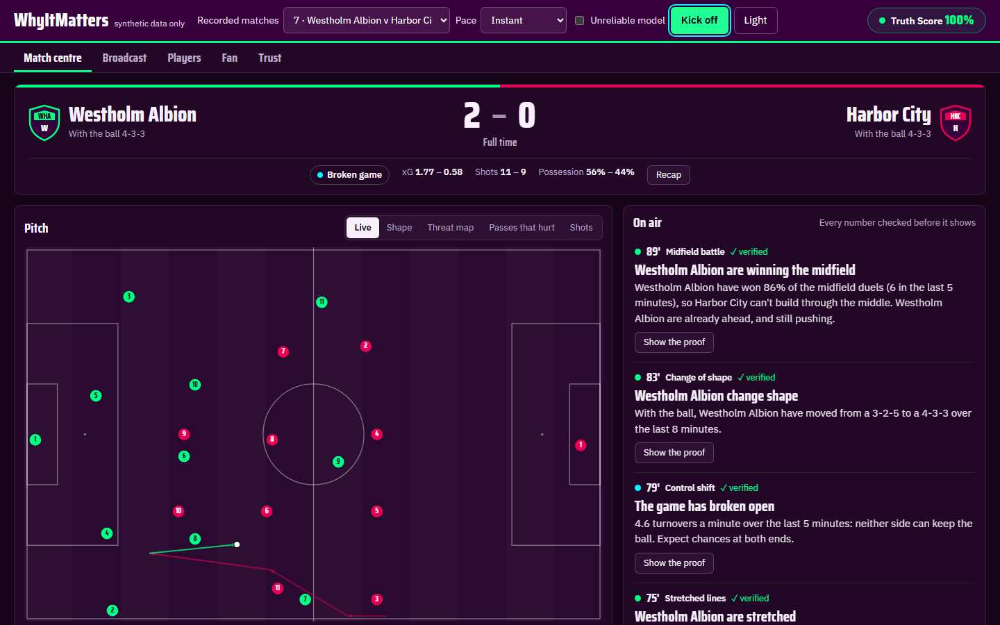
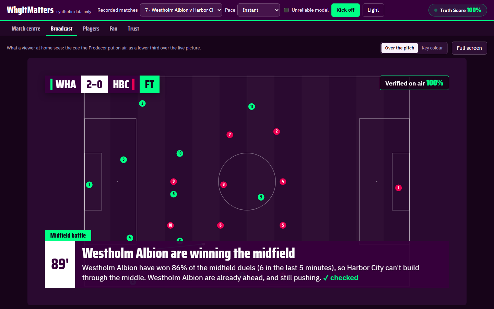
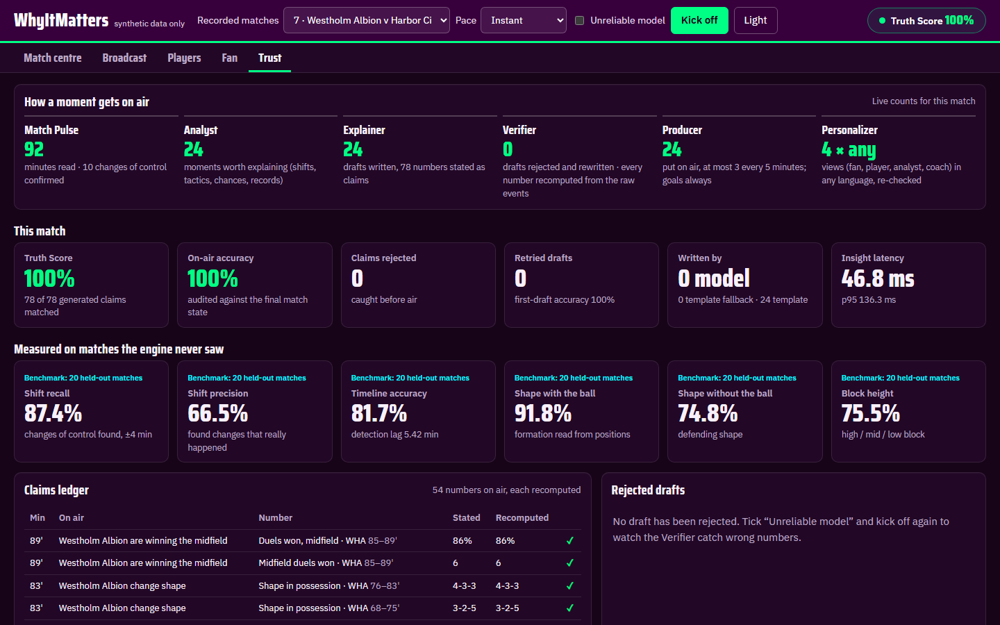
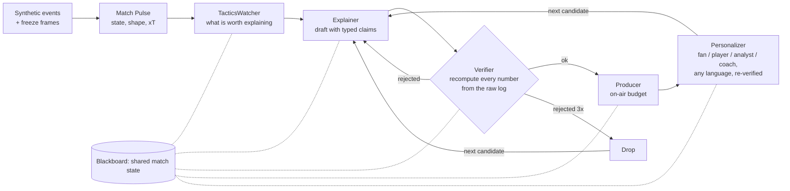

# WhyItMatters

[](https://github.com/isaacboque/why-it-matters/actions/workflows/ci.yml)

[](LICENSE)

**Reads the game like a coach, explains it like a pundit, and proves every word.**

A team of agents turns a live stream of synthetic, football-realistic match events into explainable match intelligence for studio, broadcast and streaming. Agents write the insight; a **Verifier recomputes every number from the raw event log**, and anything that does not match never goes on air.

Built solo for the Microsoft × Premier League **Inside the Game: Developer Hackathon** (challenge: *The Synthetic Match Insights Engine for Premier League Studio*).

> **Synthetic data only.** Every club, player and match in this repository is fictional and generated by code. No real Premier League data, footage or marks are used. Results validate the pipeline, not real-world football accuracy.

| Match centre | Broadcast | Trust |
| --- | --- | --- |
|  |  |  |

## Try it

| | |
| --- | --- |
| Static demo, no backend | `python -m http.server -d dist/demo`, then open http://localhost:8000 |
| Full app | `pip install -e ".[api]" && uvicorn whyitmatters.api:app --port 8000` |

A hosted copy on Azure Container Apps ran during judging and may no longer be online. To host your own, see [docs/DEPLOY.md](docs/DEPLOY.md).

Once it is open:

1. Leave Pace on **Live** (or pick **Fast**) and press **Kick off**. The Match centre fills with the pitch, xT momentum and the on-air rail.
2. On any card in the on-air rail, press **Show the proof**: the number stated next to the number recomputed from the raw event log.
3. Open **Broadcast** to see the same cue as a 16:9 lower third over the live picture.
4. Open **Trust**, tick **Unreliable model** and kick off again: the Verifier catches wrong numbers before they air, and the claims ledger and rejected drafts show it.

Good first match: `?seed=391&pace=45&faults=1` added to the app URL.

## Reproduce

From a clean clone (Python 3.11 or newer; CI runs 3.12):

```bash
git clone https://github.com/isaacboque/why-it-matters && cd why-it-matters
pip install -e ".[dev]"
pytest                                                          # 588 tests, synthetic data only
python -m whyitmatters.eval --seeds 20 --check                  # detection quality vs planted ground truth
python -m whyitmatters.agents --seed 7 --mode fan --lang ca     # the agent team on one match (add --faults 0.3 to see the Verifier work)
```

Generate and replay a match by hand:

```bash
python -m whyitmatters.simulator --seed 7 --out match.jsonl
python -m whyitmatters.pulse match.jsonl
```

Run with Docker: `docker build -t whyitmatters . && docker run -p 8000:8000 whyitmatters`.

Browser tests (Playwright + Chromium, 11 tests): `python -m playwright install chromium && pytest -m e2e`.

Rebuild the static demo: `python -m whyitmatters.api.export --seeds 7 11 23 --out dist/demo`. The committed `dist/demo/` holds 17 recorded matches (about 42 MB), relative paths only, so any static host works.

## How it works



- **Shared state:** every agent reads the same Blackboard: match state, rolling windows and the raw event log. The Verifier recomputes from the raw log, not from what the writer saw.
- **Typed handoffs:** each number travels as a `Claim` (metric, value, window or event, tolerance), so the text cannot say anything the data does not back.
- **Match Pulse engine:** control vs chaos, pressing intensity, field tilt, rhythm, team shape, Expected Threat (xT), line-breaking passes and packing.
- **Personalization:** analyst, fan, player-focus and coach modes, a "My metric" thread, EN · ES · CA offline, re-verified. Optional model-written captions in any language, guarded by number, name and length checks, retries, a template fallback and a cost cap ([docs/LLM.md](docs/LLM.md)).

## Measured, not claimed

The simulator plants known answers (who controls the game, when it turns to chaos, which chances mattered), so the engine is scored against them on matches it was never tuned on. CI fails if any of these drop below target.

| Held-out matches | Shift recall | Shift precision | Timeline accuracy | Detection lag |
| --- | --- | --- | --- | --- |
| 20 | 0.82 | 0.60 | 0.80 | 5.3 min |

The agent team is scored on seeds 0–19 (offline template generator):

| Measure | Result |
| --- | --- |
| Truth Score (claims passing the Verifier) | 1.00 |
| Truth Score with a model that mis-states 30 % of first drafts | 0.93 raw; first-draft accuracy 0.70; every retry recovers; on-air accuracy 1.00 |
| Cues per match | 22.6 (18–26); goals always air |
| Insights per match | 23.3 (control/chaos shifts, goals, changes of shape, line-breaking spells, going long, press surges, killer passes, momentum swings and more) |
| Change of shape vs the scripted shape in possession | 0.84 precision (43/51) on held-out seeds 1000–1019; 0.87 (53/61) on tuning seeds 0–19 |
| Stretched lines inside a scripted broken (chaos) spell | 0.77 (10/13) on held-out seeds; 0.67 (6/9) on tuning seeds |
| Formation detection vs scripted shape (held-out, 1,872 windows) | out of possession 0.74, in possession 0.93; block type (high / mid / low) 0.74 |
| Driver attribution: a pressing metric is among the top drivers of a correctly detected control shift | 71 % (45/63) on tuning seeds 0–19; 79 % (54/68) on held-out seeds 1000–1019 |
| Latency per insight | 12.5 ms mean, 55 ms max (the Verifier replays the log, freeze frames included) |

**How to read these numbers**

- **Truth Score** is the share of claims that match a recomputation from the raw event log, which the Verifier does independently of the writer. On clean drafts it is 1.00 by construction, so on its own it is weak evidence.
- **The stronger evidence is the fault-injection test:** with a model that mis-states 30 % of first drafts, raw Truth Score is 0.93 (first-draft accuracy 0.70), every retry recovers, and on-air accuracy is 1.00. That shows the Verifier does the catching. Try it with **Unreliable model**.
- **Precision 0.60 vs recall 0.82 is a deliberate trade-off:** the engine prefers to flag a possible shift over missing one, and the Producer budget (3 cues per 5 minutes, significance ranking) then filters what airs.
- All of this is on synthetic matches. See [docs/METHODS.md](docs/METHODS.md).

## Layout

- `src/whyitmatters/simulator/`: seeded synthetic match generator with planted ground truth and freeze frames
- `src/whyitmatters/pulse/`: Match Pulse engine (state, shape, xT, damage)
- `src/whyitmatters/agents/`: the agent team and the Microsoft Agent Framework workflow
- `src/whyitmatters/api/`: FastAPI app (SSE stream, overlay cue JSON) and the static-demo exporter
- `src/whyitmatters/eval/`: detection scoring against ground truth
- `web/`: the Studio, Fan, Players, Broadcast and Trust views
- `dist/demo/`: committed static demo (17 recorded matches)
- `infra/`: Azure deploy scripts
- `tests/`: unit, integration, stats-audit and browser tests

## Microsoft technologies used

Only what is in the code and the deploy scripts today:

| Technology | Where |
| --- | --- |
| Microsoft Agent Framework | The whole pipeline (watch, draft, verify, retry/drop, produce, personalize) is one workflow of `Executor`s with conditional edges (`src/whyitmatters/agents/workflow.py`, `WIM_ENGINE=agent_framework`, the default in the container). A parity test pins cues, verdicts and Truth Score to the inline engine on seeds 0-4 |
| Microsoft Foundry / Azure OpenAI | Optional caption writer (`WIM_GENERATOR=llm`), guarded and with a template fallback ([docs/LLM.md](docs/LLM.md)) |
| Azure Container Apps | Hosting, one script from Cloud Shell, one replica kept warm ([docs/DEPLOY.md](docs/DEPLOY.md), `infra/deploy.sh`) |
| GitHub Actions and GHCR | CI (lint, tests, detection eval gate, Playwright browser tests); image published to GHCR (`.github/workflows/`) |

GitHub Copilot is not used in the shipped code, so it is not listed.

## Path to production

This is a prototype on synthetic data. What it would take to run on a real feed:

- **Provider adapter.** One function per provider maps its event feed onto our schema (`src/whyitmatters/schema.py`) and nothing downstream changes. Per event: `id`, `seq`, `t`, `period`, `minute`, `type`, `side`, `player_id`, `possession_id`, `x`/`y` and `end_x`/`end_y` (in the acting team's 105 × 68 m coordinates), `outcome`, `receiver_id`, `under_pressure`, `xg`, `score_home`/`score_away`, plus a `freeze` frame of all 22 players where the provider has tracking. Field definitions are in [docs/DATA.md](docs/DATA.md). The adapter itself is not built yet.
- **Latency.** Measured offline on the replayed log, not on a network. A live feed adds the provider's own delay.
- **On-air budget.** The Producer allows at most 3 cues per rolling 5 match minutes; goals always air. Tune per broadcaster.
- **Overlay cue API.** `GET /matches/{seed}/cues` returns timed cues (`t_in`, `t_out`, `priority`, `headline`, `body`, evidence event ids, claims) for a graphics partner. Today it is pull-based per match; a push channel would be next.
- **Audit trail.** Every number on air is a typed claim with its recomputed value; the claims ledger in the Trust tab is that trail. Persisting it per broadcast is not built yet.
- **Cost guard.** `WIM_LLM_MAX_CALLS` caps model requests per match and everything falls back to offline templates; the default path needs no model at all.

## Docs

- [SPEC.md](SPEC.md): the problem, users, success criteria and architecture
- [docs/DATA.md](docs/DATA.md): why the data is synthetic, the file format with real example lines, coordinates, ground truth, and a calibration table against public league averages
- [docs/METHODS.md](docs/METHODS.md): every metric with its formula, parameters, source, the test that pins it and how it is validated
- [docs/METRICS.md](docs/METRICS.md): every metric a number can come from, in fan and analyst depth (served at `GET /glossary`)
- [docs/STATS-AUDIT.md](docs/STATS-AUDIT.md): every number on screen recomputed from the raw event log by an independent checker
- [docs/LLM.md](docs/LLM.md): optional model-written captions and their guardrails
- [docs/DEPLOY.md](docs/DEPLOY.md): Azure Container Apps deployment

API docs are served at `/docs`; the live feed is `GET /matches/{seed}/stream` (Server-Sent Events, a 90-minute match in about 3 minutes, `?duration=0` for instant).

## How I built this

I built this with Claude (Claude Code for implementation, Claude chat for planning), and the commit trailers show where. What I decided, what Claude did and how the output was checked are in [docs/HOW-I-BUILT-THIS.md](docs/HOW-I-BUILT-THIS.md).

## License

MIT, see [LICENSE](LICENSE).
